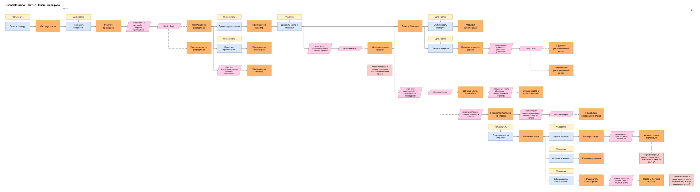
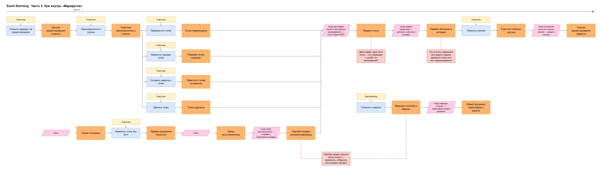

# Event Storming: границы через события

## Нотация

Цвета стикеров везде одни и те же:

| Цвет | Что это | Как формулирую |
|------|---------|----------------|
| 🟧 оранжевый | **доменное событие** — то, что произошло с маршрутом и уже не отменится | глагол в прошедшем времени: «Точка перемещена» |
| 🟦 синий | **команда** — чего хочет участник или система | инфинитив: «Переместить точку» |
| 🟨 жёлтый | **актор** — от чьего имени идёт команда | название роли: «Организатор», «Модератор» |
| 🟪 розовый параллелограмм | **политика** — автоматическая реакция на событие, или **внешняя система** | «когда X → Y»; геопровайдеры, Email · Push, сеть |
| 🟥 красный | **hotspot** — место, где ответа пока нет | формулирую вопросом |

## Шаг 1. Доска

Доска состоит из двух частей. Сначала жизнь маршрута целиком, потом зум внутрь «Маршрутов» — core-поддомена, где живут сессия, офлайн и откат. Время везде идёт слева направо.

### Часть 1. Жизнь маршрута

От создания маршрута до модерации: что происходит с маршрутом, пока его собирают, публикуют, на него жалуются и откатывают. Доска читается слева направо одной линией, стрелки показывают причинность: «Создать маршрут → Маршрут создан → Пригласить участника → Участник приглашён → …». Актор стоит над своей командой. Основная линия — счастливый путь, развилки уходят на дорожки ниже.

Акторы — роли, а не люди. Один и тот же человек по ходу ленты переходит из роли в роль:

- **Гость** — ещё не зарегистрирован. На доске его нет: регистрация и вход живут у внешнего IdP, наш процесс на них не реагирует и начинается уже с авторизованного пользователя.
- **Пользователь** — авторизован, но в конкретном маршруте пока никто: просматривает, принимает приглашение, жалуется на публичный маршрут.
- **Организатор** и **Участник** — роли внутри конкретного маршрута. Участник правит маршрут. Организатор — участник с дополнительными правами: он же создаёт маршрут, приглашает, публикует и откатывает к прошлой версии. Роль появляется, когда пользователь создал маршрут или принял приглашение, — в другом маршруте тот же человек снова просто пользователь.
- **Модератор** — отдельная роль платформы, не связанная с маршрутами: разбирает жалобы, скрывает маршруты, блокирует нарушителей.

У многих событий актора нет — они случаются без человека. Их запускает розовая **политика** «когда произошло X → сделать Y». Если результат зависит от **внешней системы** — геопровайдеров или Email · Push, — она стоит между политикой и событием, а её ответ нарисован пунктиром. Политики связывают события без участия людей, поэтому почти каждая из них — кандидат на границу между контекстами.

Красный стикер — **hotspot**, вопрос, на который пока нет ответа; красный пунктир привязывает его к событию. На первой части доски их три:

- **Когда место попадает в каталог — при поиске или при добавлении точки?** У «Место внесено в каталог» политика реагирует не на событие, а на запрос: выбор места — это поиск, событий он не порождает, но каталог от него растёт. От ответа зависит, откуда «Маршруты» берут `placeId`: приходит ли он в команде готовым или «Маршруты» синхронно ждут Геокаталог.
- **Маршрут скрыт, а шаринг-ссылки живы — открывается ли он по ссылке?** «Маршрут скрыт» слышат «Маршруты» и снимают его с публикации, но шаринг-токены принадлежат «Доступу», и о скрытии он не знает.
- **Права отозваны, а живая сессия открыта — рвать сразу или при переподключении?** Realtime BFF проверяет права только при handshake, поэтому заблокированный участник может продолжать править, пока не переподключится.

**Развилки** — это несколько стрелок из одной точки. У доставки приглашения два исхода: Email · Push доставил или не доставил. После доставки их три: пользователь принял приглашение, отклонил его или не ответил, и тогда по сроку сработала политика. Добавление места ветвится: если место уже в каталоге, точка добавляется сразу, если нет — сначала карточку собирают у провайдеров. После добавления точки у организатора два пути: опубликовать маршрут или откатить его к прошлой версии; у уведомления об откате, как и у приглашения, есть недоставка. Для провайдера геоданных ответ «не отвечает» ведёт в отдельную цепочку: провайдер выводится из опроса и возвращается, когда снова отвечает.

**Жалоба — отдельная цепочка** без входящей стрелки: пожаловаться может любой пользователь в любой момент, пока маршрут опубликован. Дальше она расходится на три решения модератора: скрыть маршрут, отклонить жалобу, заблокировать пользователя.

.

draw.io: [`views/diagrams/event-storming-part-1.drawio.svg`](views/diagrams/event-storming-part-1.drawio.svg)

### Часть 2. Зум внутрь «Маршрутов»

Первая часть показала жизнь маршрута снаружи. Здесь — что происходит, пока маршрут правят вместе: живая сессия, слияние параллельных правок, запись в историю, офлайн и синхронизация, откат во время сессии. Читается так же, как первая часть: актор над командой, команда → событие → следующая команда. У событий без человека на месте команды — политика или внешняя система. Слияние правок, запись в историю, отправка накопленных офлайн-правок, пересборка живого документа после отката и закрытие сессии — это политики: они срабатывают сами, по предыдущему событию. Потерю и восстановление связи никто не выбирает — их приносит внешняя система «Сеть», её ответ нарисован пунктиром.

**Развилки и связи.** После того как участник присоединился к сессии, у него четыре вида правок: переместить точку, изменить порядок, оставить заметку, удалить точку. Все четыре сходятся в одну политику — слияние через CRDT, — а за ней в запись в историю: какой бы ни была правка, дальше она проходит одинаковый путь. Туда же, в слияние, приходят офлайн-правки после восстановления связи. **Офлайн — отдельная цепочка** без входящей стрелки: связь может пропасть в любой момент сессии, и её потерю приносит «Сеть», а не человек. **Откат — тоже отдельная цепочка**: организатор запускает его когда угодно, а политика пересобирает живой документ у всех, кто сейчас в сессии. Сессия заканчивается, когда её покидает последний участник.

Hotspot'ов здесь три, и каждый упирается в меру сценария из [дерева полезности](02-utility-tree.md) — пока на вопрос нет ответа, мера не проверяема:

- **Двое правят одно поле точки — кто побеждает и узнаёт ли проигравший?** CRDT сольёт правки без конфликта, но [S8](02-utility-tree.md) обещает авторезолв только для *неперекрывающихся* полей. Если оба двигают одну и ту же точку, одна правка молча проиграет.
- **Что считать операцией для аудита: каждое движение точки или итог перетаскивания?** [S7](02-utility-tree.md) требует «100% операций в логе ≤ 1 с». Перетаскивание — это десятки промежуточных движений в секунду; писать каждое — раздуть историю, писать итог — решить, где у правки конец.
- **Офлайн-правки пришли после отката — применить, отбросить или показать автору?** Участник правил без сети, а организатор тем временем откатил маршрут. [S5](02-utility-tree.md) обещает «потерь нет», [S6](02-utility-tree.md) — что состояние восстановлено к версии N. Оба обещания сразу не выполнить.

draw.io: [`views/diagrams/event-storming-part-2.drawio.svg`](views/diagrams/event-storming-part-2.drawio.svg).

### Что видно на доске

Пять вещей, которые были только словами или которые не были видны ранее.

**Политики легли на стрелки карты сервисов.** Почти каждая политика, которая связывает события без человека, соединяет два разных куска системы: «маршрут скрыт → снять с публикации» — Модерацию и Маршруты, «пользователь заблокирован → отозвать права» — Модерацию и Доступ, «участник приглашён → отправить приглашение» — Доступ и Уведомления, «маршрут откачен → уведомить участников» — Маршруты и Уведомления, «данные места обновились → решить, освежать ли снимок» — Геокаталог и Маршруты. Это ровно пунктирные стрелки-события на [карте сервисов](views/service-map.md). Там я их нарисовал из головы, здесь они проступили сами — из того, что событие случилось без актора.

**У supporting-контекстов есть своё поведение во времени.** В [service-boundaries](05-service-boundaries.md) Доступ и Геокаталог описаны данными: участники и роли, карточки и кеш. На доске у обоих нашлись политики с таймером, которые сами, без команды, меняют состояние: приглашение истекает по сроку, карточка места перезапрашивается, когда устарела, провайдер выводится из опроса и возвращается обратно. Это уже не хранилища, а участники процесса.

**Развилки.** У доставки приглашения два исхода, у ответа на приглашение — три, у жалобы — три решения модератора, у уведомления об откате — недоставка. В [ДЗ-3](04-capabilities.md) каждая возможность описана одной строкой, и «управление доступом к маршруту» там выглядит так, будто у приглашения только один финал. А развилки — это как раз те места, где процесс может закончиться не так, как задумано, и где нужны свои правила.

**Всё сходится в слияние и запись в историю.** Во второй части четыре вида правок онлайн и офлайн-правки после реконнекта приходят в одну политику слияния через CRDT, а за ней — в запись в историю. Это ядро «Маршрутов»: какой бы ни была правка и откуда бы она ни пришла, дальше путь один. Вокруг него живая сессия — открыть, присоединиться, покинуть, закрыть — и офлайн говорят на своём языке: сессия, участник онлайн, офлайн-очередь, живой документ. Отдельный ли это контекст, разбираю в [шаге 2](#шаг-2-bounded-context).

**Шесть hotspot'ов.** Ни об одном из этих вопросов я не задумывался, пока не разложил события по времени. По смыслу они распадаются на две группы.

- *Три — на границах между сервисами.* Когда место попадает в каталог и откуда «Маршруты» берут `placeId`; открывается ли по шаринг-ссылке скрытый маршрут, если скрытие слышат «Маршруты», а ссылки принадлежат «Доступу»; что делать с живой сессией, если права уже отозваны, а [Realtime BFF](views/c4-container.md) проверяет их только при handshake. Каждый из них — дыра в контракте, которую не видно ни на карте сервисов, ни на C4.
- *Три — внутри сессии, и каждый делает непроверяемой меру из [дерева полезности](02-utility-tree.md):* кто побеждает, когда двое правят одно поле (S8), что считать операцией для аудита (S7), что делать с офлайн-правками после отката (S5 против S6).

## Шаг 2. Bounded Context

Получилось пять контекстов.

### 1. Маршруты

**События:** маршрут создан, точка добавлена, маршрут опубликован, маршрут откачен к версии, маршрут снят с публикации, снимок места в точке обновлён; из второй части — точка перемещена, порядок точек изменён, заметка к точке оставлена, точка удалена, правки слиты, правка записана в историю, живой документ пересобран с версии, а также события живой сессии и офлайна (о них ниже).

**Язык:** маршрут, точка, версия, история, снимок места, живой документ.

**Владеет:** потоком событий маршрута, снапшотами, проекцией текущего состояния, точками и их порядком, живым CRDT-документом сессии.

### 2. Доступ

**События:** участник приглашён, приглашение принято, приглашение отклонено, приглашение истекло, права участника отозваны.

**Язык:** участник, роль, приглашение, срок приглашения, шаринг-ссылка.

**Владеет:** составом участников, ролями, приглашениями, шаринг-токенами.

### 3. Геокаталог

**События:** место внесено в каталог, данные места обновились, провайдер выведен из опроса, провайдер возвращён в опрос.

**Язык:** место, карточка, `placeId`, провайдер, срок карточки.

**Владеет:** нормализованными карточками мест, кешем ответов провайдеров, соответствием внешнего id внутреннему `placeId`.

Кластер небольшой: поиск места — запрос, событий он не даёт. Держится кластер на трёх политиках, и две из них завязаны на время.

### 4. Модерация

**События:** жалоба подана, жалоба отклонена, маршрут скрыт, пользователь заблокирован.

**Язык:** жалоба, нарушение, решение, нарушитель.

**Владеет:** жалобами, решениями модерации и их причинами, блокировками пользователей.

### 5. Уведомления

**События:** приглашение доставлено, приглашение не доставлено, участники уведомлены об откате, участники не уведомлены об откате.

**Язык:** получатель, канал, сообщение, статус доставки.

**Владеет:** заявками на уведомление, историей статусов доставки, шаблонами, маршрутизацией «канал → провайдер».

### Живая сессия: кластер есть, контекста нет

Во второй части доски проступил ещё один кластер: сессия открыта, участник присоединился, участник покинул сессию, сессия закрыта, связь потеряна, правка сохранена локально, связь восстановлена, офлайн-правки синхронизированы. У него свой язык — сессия, участник онлайн, офлайн-очередь — и свои политики: закрыть сессию, когда вышел последний участник; отправить накопленные правки после реконнекта. По формальному признаку это кандидат в шестой контекст: поведение у него есть.

Всё-таки не выделяю. Проверяю тем же вопросом, что задаю всем остальным границам: есть ли у кластера своя модель? Нет. «Точка перемещена» в сессии и в истории — одно и то же событие про одну и ту же точку; живой документ — это текущее состояние маршрута, а не отдельная сущность; офлайн-правка — та же правка, только отложенная. Сессия — способ, которым правка доходит до маршрута, а не другой взгляд на маршрут.

И цена границы была бы высокой. Каждая правка пересекала бы её дважды — на слиянии и на записи в историю, а откат шёл бы в обратную сторону, пересобирая живой документ. Ни одна сторона не смогла бы поменять правило слияния или формат правки в одиночку, а это на Context Map называется партнёрством — самой дорогой связью. Граница, которая обязывает к партнёрству на каждом действии пользователя, проведена не там.

### Один термин — разные модели

Места и точки, участника и получателя я уже разобрал в ДЗ-3: [место и точка](05-service-boundaries.md#место-и-точка--разные-модели), [участник и получатель](05-service-boundaries.md#участник-и-получатель--разные-модели). Доска добавила ещё три слова.

**Приглашение.** В Доступе это роль со сроком: кто пригласил, на какой маршрут, когда истекает. В Уведомлениях приглашения нет вообще — есть сообщение получателю по каналу. Событие «Приглашение доставлено» на доске названо на языке Доступа, потому что так его видит пользователь; внутри Уведомлений это просто «сообщение доставлено», и знать, что именно в нём, Уведомлениям не нужно.

**Сессия.** В Маршрутах это живое совместное редактирование: кто сейчас онлайн, какой документ открыт, что накопилось офлайн. В Авторизации сессия — это вход: токен и срок его жизни. Одно слово, два процесса, и если завести общую «сессию», в неё поедут и курсоры участников, и ротация ключей.

**Блокировка.** В Модерации это решение: кого, за что, на какой срок. В Доступе — следствие решения: отозванные права. А в Маршрутах блокировки нет вовсе: правки идут без блокировок, через CRDT, это прямое требование D4. Если бы «заблокировать» значило одно и то же везде, кто-нибудь рано или поздно попытался бы «заблокировать точку на время правки».

## Шаг 3. Context Map

Карта связей с разбором каждой стрелки — в отдельном файле: [`views/context-map.md`](views/context-map.md).

## Шаг 4. Сверка с ДЗ-3

В ДЗ-3 получилось [шесть сервисов](05-service-boundaries.md), здесь — пять контекстов. Сравниваю.

| Сервис из ДЗ-3 | Контекст из ДЗ-4 | Итог |
|----------------|------------------|------|
| Маршруты | Маршруты | совпало, но внутри проступил кластер живой сессии |
| Геокаталог | Геокаталог | совпало; кластер небольшой, держится на политиках |
| Доступ | Доступ | совпало, и граница окрепла: нашлось своё поведение |
| Модерация | Модерация | совпало |
| Уведомления | Уведомления | совпало |
| Авторизация | — | **не проступил** |

Пять из шести совпали без поправок, так что нарезка от возможностей проверку прошла.

### Расхождение 1. Авторизация на доске не появилась

Сначала я поставил первым событием «Пользователь зарегистрирован» — и убрал. Регистрацию и вход ведёт внешний IdP, это не наш доменный факт: после регистрации в нашей системе ничего не происходит, ни одна политика на неё не реагирует. А стрелка «зарегистрирован → создать маршрут» создавала ложное впечатление, будто каждый маршрут начинается с регистрации.

Без этого события у Авторизации на доске не осталось ни одного стикера. Сервис из ДЗ-3 от этого не становится лишним — просто доска рисует то, что происходит с маршрутом, а вход случается раньше и в стороне: пользователь приходит с готовым токеном. Вывод для себя: доска видит только то, что попадает в ленту событий, и сервис, который работает «на входе», она пропустит. Список возможностей такой сервис не теряет, зато и доказать его границу не помогает — поэтому нужны оба взгляда. На [Context Map](views/context-map.md) Авторизация всё равно нужна — как ACL на входе каждого контекста.

### Расхождение 2. Живая сессия чуть не отделилась

Во второй части доски проступил кластер со своим языком и своими политиками: открыть и закрыть сессию, потерять и восстановить связь, отправить накопленные правки. Если верить только кластерам, это шестой контекст — а в ДЗ-3 я [сознательно оставил историю и realtime внутри Маршрутов](05-service-boundaries.md#1-маршруты-возможность-1-core).

Не разделяю, и теперь могу это обосновать. В ДЗ-3 у меня был только тезис «это один жизненный цикл» — с ним трудно спорить, но и проверить его нечем. Доска даёт два признака, которые проверяются. Первый — у сессии нет своей модели: «точка перемещена» в сессии и в истории одно и то же событие про одну и ту же точку. Второй — граница сделала бы неизбежным партнёрство: каждая правка пересекала бы её на слиянии и записи в историю, откат — в обратную сторону. Подробно — в [шаге 2](#живая-сессия-кластер-есть-контекста-нет).

### Расхождение 3. У Доступа и Геокаталога появилось поведение

В ДЗ-3 оба описаны данными: участники и роли, карточки и кеш. По такому описанию легко решить, что это две таблицы, которым не обязательно быть отдельными сервисами. На доске у обоих нашлись политики с таймером, которые сами, без команды, меняют состояние: приглашение истекает по сроку, карточка перезапрашивается, когда устарела, провайдер выводится из опроса и возвращается.

Граница осталась на месте, но теперь у неё есть опора: сервис, который сам что-то делает по времени, не сольёшь с соседом как «просто ещё одну таблицу». С Геокаталогом оговорка: кластер на доске небольшой, потому что поиск места — запрос, а не событие. Отдельным сервисом он остаётся по причинам из ДЗ-3 — другие причины меняться и другой профиль нагрузки, — доска их не опровергла, но и не добавила.

### Расхождение 4. Связи между сервисами проступили сами

В ДЗ-3 пунктирные стрелки-события на [карте сервисов](views/service-map.md) я провёл из головы. На доске они появились без моего участия: везде, где у события не нашлось актора, его запускала политика, и почти каждая такая политика соединила два разных сервиса — «маршрут скрыт → снять с публикации», «пользователь заблокирован → отозвать права», «участник приглашён → отправить приглашение», «маршрут откачен → уведомить», «данные места обновились → решить про снимок». Все пять совпали со стрелками карты — одни и те же связи получились двумя путями, и это для меня самый весомый результат сверки.

### Расхождение 5. Шесть открытых вопросов

Ни одного из шести hotspot'ов в ДЗ-3 не было. Все они про ситуации «одно уже случилось, а другое ещё идёт»: права отозвали посреди сессии, маршрут откатили, пока участник был офлайн. В списке возможностей каждая возможность живёт сама по себе, и такие пересечения там не встретить.

Три из них — на границах, и два превратились на [Context Map](views/context-map.md#что-карта-говорит-про-риски) в недостающие связи: событие «права отозваны» не доходит до живой сессии, скрытие маршрута не доходит до Доступа, которому принадлежат шаринг-ссылки. Третий — когда место попадает в каталог — ставит под вопрос сам контракт Геокаталога с Маршрутами. Ещё три — внутри сессии, и каждый делает непроверяемой меру из [дерева полезности](02-utility-tree.md): S5 против S6, S7, S8. Оставляю все шесть открытыми.

### Вывод

Нарезку из ДЗ-3 менять не нужно: пять сервисов нашлись на доске, шестой не нашёлся по понятной причине. Зато у границ появились доводы, которых раньше не было: у Доступа и Геокаталога — собственное поведение во времени, у решения держать сессию внутри Маршрутов — проверяемый признак вместо тезиса, у событийных связей — второй, независимый источник.

И появился список того, что ещё не решено: шесть hotspot'ов и две недостающие связи на Context Map.
