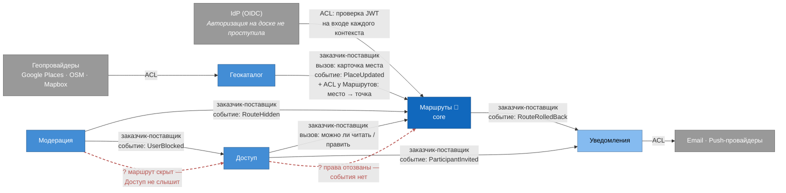

# Context Map

Пять контекстов из [`07-event-storming.md`](../07-event-storming.md) и то, как они связаны. Карта сервисов из ДЗ-3 показывала, кто кому что передаёт; здесь важнее другое — **чьё изменение ломает соседа и кому из двух придётся подстроиться**.

## Типы связей

**Партнёрство.** Общий контракт принадлежит обоим, поэтому любая его правка выкатывается в двух контекстах сразу. Это дорого: без созвона двух команд ничего не поменять.

**Заказчик-поставщик.** Зависимость в одну сторону: заказчику нужно то, что делает поставщик, и он принимает его правила. В каждой такой связи отмечаю, **кто владеет контрактом**: в вызове — отвечающая сторона, в событии — публикующая.

**ACL (anti-corruption layer).** Переводчик на входе: всё, что приходит снаружи, превращается в наши понятия до того, как попадёт в модель контекста. Нужен там, где чужой формат может меняться без нашего ведома.

Как выбираю между вызовом и событием — по критерию из [`06-cohesion-coupling.md`](../06-cohesion-coupling.md#чем-эти-два-риска-отличаются): если ответ нужен прямо сейчас, чтобы продолжить действие, — это вызов; если нужно отреагировать на то, что уже случилось, — событие.

## Карта

Сплошная стрелка — существующая связь, от поставщика к заказчику. Красный пунктир — связь, которой сейчас нет, но о которой спрашивает hotspot с доски. Цвет — тип поддомена, как на [карте сервисов](service-map.md): core, supporting, generic. Связь IdP нарисована только к Маршрутам, чтобы не перечёркивать схему: проверка JWT стоит на входе каждого контекста.

## Разбор связей

### Геокаталог → Маршруты: заказчик-поставщик, плюс ACL на стороне Маршрутов

Маршруты спрашивают карточку места, когда участник добавляет точку, и слушают `PlaceUpdated`, чтобы решить, освежать ли снимок. Контракт у Геокаталога: как устроена карточка, решает он, а Маршруты подстраиваются. Обратной зависимости нет — Геокаталог продолжит работать, даже если Маршрутов не станет.

На входе в Маршруты стоит перевод: из карточки места берутся только отображаемые поля и превращаются в снимок внутри точки — [место и точка — разные модели](../05-service-boundaries.md#место-и-точка--разные-модели). Поля, которые Геокаталог добавит ради своего кеша, до Event Store маршрута не доедут.

Здесь же висит [hotspot](../07-event-storming.md#что-видно-на-доске) «когда место попадает в каталог»: от ответа зависит, останется ли эта связь вызовом при каждом добавлении точки или `placeId` будет приходить в команде готовым.

### Доступ → Маршруты: заказчик-поставщик, синхронный вызов

Перед каждой командой, каждым чтением и при входе в живую сессию Маршруты спрашивают «можно ли этому пользователю читать / править этот маршрут». Ответ нужен прямо сейчас — без него действие не продолжить, поэтому это вызов, а не событие. Контракт `allow | deny` у Доступа.

Это самая нагруженная связь на карте, и она же самая чувствительная к отказам — подробнее в рисках.

### Модерация → Маршруты и Модерация → Доступ: заказчик-поставщик через событие

Модерация принимает решение и публикует факт: `RouteHidden` слышат Маршруты и снимают маршрут с публикации, `UserBlocked` слышит Доступ и отзывает права. Контракт у издателя — Модерации. Применить решение — дело соседей: Модерация не знает ни Event Store маршрута, ни таблицы участников.

### Доступ → Уведомления и Маршруты → Уведомления: заказчик-поставщик через событие

`ParticipantInvited` и `RouteRolledBack` уходят в Уведомления. Обратной стрелки нет: Уведомления ничего не возвращают — ни статуса, ни подтверждения. Недоступность Email · Push не может дойти ни до приглашения, ни до отката, потому что дороги обратно не существует. Обратная сторона: Маршруты и Доступ не узнают, дошло ли письмо. Если это понадобится, ответ лежит в статусах доставки у Уведомлений, а не у них.

### Геопровайдеры → Геокаталог: ACL

Google Places, Overpass и Mapbox отвечают по-разному, по-разному сообщают об ошибках и по-разному ограничивают частоту запросов. На границе стоят адаптеры, которые переводят чужой ответ в нашу карточку места; дальше внутри Геокаталога никто не знает, что такое Overpass QL. Технически это [тот же DIP из ДЗ-3](../06-cohesion-coupling.md#один-приём-solid-dip): интерфейс «Геопровайдер» объявляет Геокаталог, адаптеры его реализуют. DIP и ACL здесь — один приём, увиденный с двух сторон.

### Уведомления → Email · Push: ACL

Email и пуш по-своему понимают «доставлено»: SMTP-сервер принял письмо, пуш-сервис принял уведомление — это ещё не значит, что человек его увидел. Адаптер сводит их ответы к нашим статусам доставки, и Уведомления дальше работают только с ними.

### IdP → все контексты: ACL

На доске Авторизации нет — [почему, разобрано в сверке](../07-event-storming.md#расхождение-1-авторизация-на-доске-не-появилась). На карте без неё не обойтись: пользователь в каждом контексте появляется именно отсюда. Каждый контекст проверяет JWT на входе, и модель пользователя IdP дальше проверки не идёт: внутри это уже участник, получатель или нарушитель.

## Что карта говорит про риски

**Партнёрств нет.** Значит, любой контекст можно менять без согласования релиза с соседом, пока не трогаешь свой опубликованный контракт. Единственный кандидат был внутри Маршрутов — живая сессия против маршрута, — и именно поэтому [я не провёл там границу](../07-event-storming.md#живая-сессия-кластер-есть-контекста-нет).

**Циклов нет.** Если пройти по стрелкам, назад к исходному контексту не вернуться. Уведомления — в самом конце: от них никто ничего не ждёт, поэтому их сбой ни на кого не влияет.

**Внешние системы подключены только через ACL.** Замена геопровайдера, канала доставки или IdP затрагивает один контекст — тот, у которого стоит адаптер.

**Core зависит от трёх supporting-контекстов, и от Доступа — синхронно.** Маршруты ниже по потоку у Геокаталога, Доступа и Модерации. С Модерацией связь событийная и безопасная. С Геокаталогом вызов происходит только при добавлении точки, и при его недоступности снимок уже лежит в команде. А вот Доступ стоит на пути каждой правки: это ровно тот симптом, о котором говорили на лекции, — одно синхронно ждёт другое. Если Доступ тормозит, тормозит живое редактирование, и [S2 «правка видна остальным ≤ 300 мс»](../02-utility-tree.md) под угрозой; если Доступ лежит, править нельзя вообще. Как это снять — кешировать решения, класть роль в токен, перейти на событие «права изменились» — это вопрос следующего ДЗ про модель взаимодействия. Здесь важно, что карта его показала.

**Два hotspot'а — это недостающие стрелки.** Красный пунктир на карте — связи, которых нет, хотя доска о них спрашивает:

- *Доступ → Маршруты, событие «права отозваны».* Сейчас Маршруты узнают о правах только синхронным вызовом, а живая сессия проверяет их один раз, при входе. Заблокированный участник продолжает править, пока не переподключится.
- *Модерация → Доступ, `RouteHidden`.* Скрытие слышат только Маршруты, а шаринг-ссылки принадлежат Доступу. Открывается ли скрытый маршрут по ссылке — зависит от того, кто первым проверит.

Обе дыры не видны ни на [карте сервисов](service-map.md), ни на [C4](c4-container.md): там нарисованы связи, которые есть, а не те, которых не хватает. Карта контекстов с доской за спиной показала их сразу.

И чего карта не покажет. [Риск 2 из ДЗ-3](../06-cohesion-coupling.md#риск-2-маршруты-сами-лезут-в-кеш-геокаталога) — Маршруты читают кеш Геокаталога напрямую — здесь не отобразился бы никак: на карте только договорённые связи, а прямое чтение чужого хранилища ни о чём не договаривается. Такое ловится ревью кода и запретом доступа к чужим базам, а не диаграммой.
